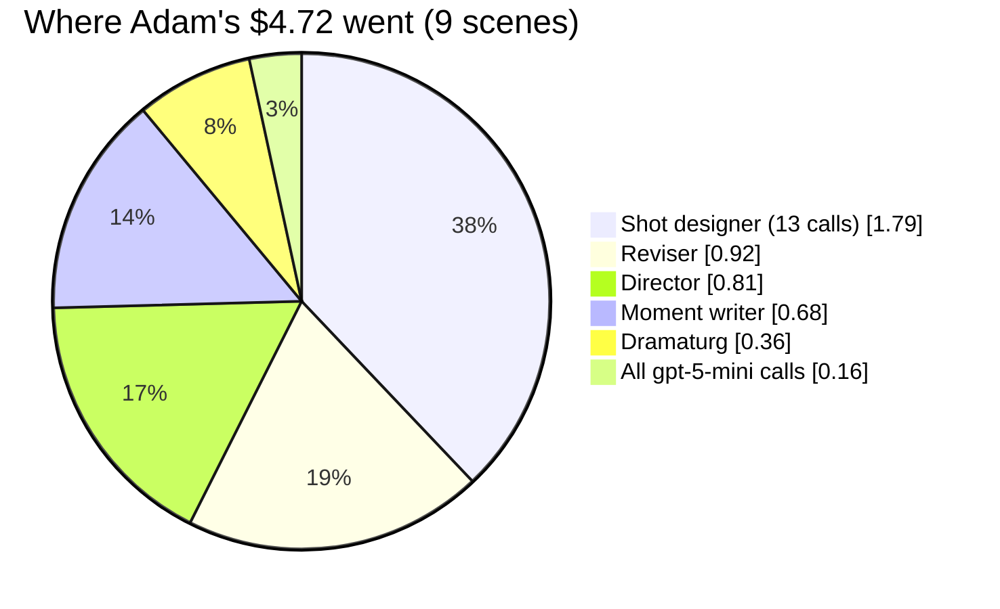
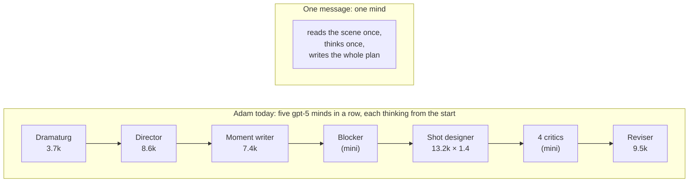
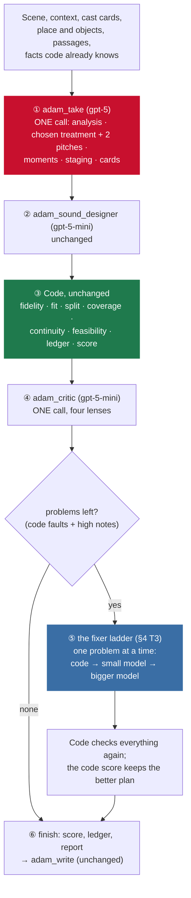
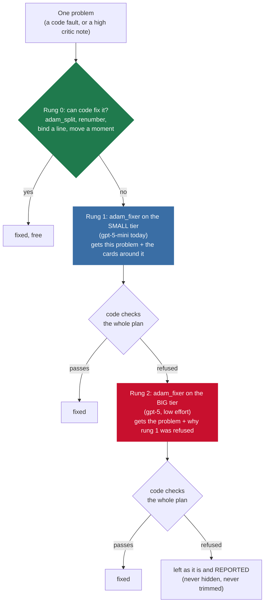
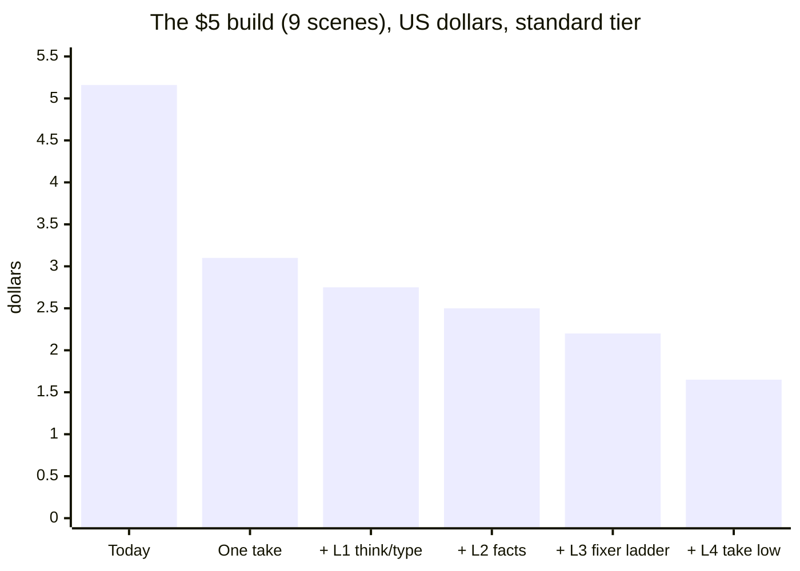
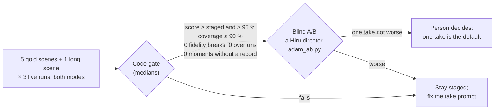
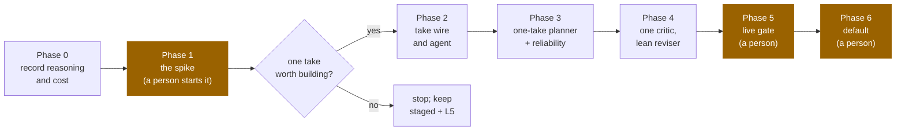

# Shot Planner Adam in one take: the same plans for well under half the cost: plan

Status: Phases 0 to 4 built offline and the Phase 1 spike written, 2026-11-05 (see [IMPLEMENTED.md](IMPLEMENTED.md)); the
live runs, the default and the migration are a person's. It builds on [plan/2026-11-04b](../2026-11-04b/PLAN.md)
(Shot Planner Adam) and [plan/2026-11-04c](../2026-11-04c/PLAN.md) (make Adam defend the scene) and changes none of
their rules: never invent story, never trim a line, the Veo clock (4 / 6 / 8 s, 2.2 words a second), every elaboration
labelled and removable, nothing lost without a record. §9 lists the person's decisions so far and the ones still open.

**Goal:** the build that cost $5.16 costs **$1–2**, on the **standard API tier** (reliable, no Flex), and the plans are
at least as good, judged by the same code score and the same blind A/B that judge Adam today.

## 1. What the $5 build actually spent

Measured from the hosted `token_usage` table (read-only, 2026-11-05) for job `f89a99a4…` (2026-11-04, 17:56–18:30 UTC,
**9 scenes**, 112 model calls), priced at OpenAI list prices (gpt-5 $1.25 / $0.125 cached / $10 per million tokens;
gpt-5-mini $0.25 / $0.025 / $2).

| Stage | Agent | Model | Calls | Prompt / call | Output / call (incl. reasoning) | Cost | Share |
|---|---|---|---|---|---|---|---|
| design | shot designer | gpt-5 | **13** (4 sent back) | 10,453 | **13,238** (max 21,573) | $1.79 | 35 % |
| revise | reviser | gpt-5 | 9 (every scene) | 7,729 | **9,493** | $0.92 | 18 % |
| conceive | director | gpt-5 | 9 | 5,553 | 8,581 | $0.81 | 16 % |
| imagine | moment writer | gpt-5 | 9 | 3,784 | 7,405 | $0.68 | 13 % |
| analyse | dramaturg | gpt-5 | 9 | 3,782 | 3,735 | $0.36 | 7 % |
| screen, sound, stage | critics ×4, sound designer, blocker | gpt-5-mini | 54 | | | $0.16 | 3 % |
| (not Adam) | structure build, canon extract | gpt-5 / mini | 9 | | | $0.44 | 8 % |
| **Adam only** | | | 103 | | | **$4.72 = $0.52 a scene** | |



What the numbers say:

- **93 % of the bill is gpt-5 output**, and most of that output is hidden reasoning. The reviser writes about 600
  visible tokens and is billed for 9,500; the designer writes about 4,500 and is billed for 13,200. Prompts cost
  $0.21 in total, so shortening prompts is not where the money is.
- **gpt-5 thinks about 38,000 tokens per scene**, across five agents that each re-read the scene and the previous
  stage's JSON.
- The designer was sent back in 4 of 9 scenes, and the reviser ran in all 9.
- The gpt-5-mini calls (critics, sound, blocker) cost 3 %. They are not the problem.

## 2. What one message to ChatGPT showed

The person asked ChatGPT, in **one message**, for a breakdown of the same test scene and got this (abridged; full text
in §11):

> MW two-shot, 6 s, slow push-in. We come in mid-laugh… Her phone lies face-down on the bench between them [E: plant]…
> CU Anudi, 8 s, slow push-in. The father's voice comes through the phone, thin and tinny. On "marriage", the smile stays
> on her lips a beat after her eyes change… ECU eyes, 4 s… the scene's one rhythm break… INSERT hands, 4 s. Her thumb
> ends the call, and she turns the phone face-down again [S + E: payoff]… MW on Dasun, 8 s, locked-off… End image:
> Dasun and the empty space beside him.

| | One message to ChatGPT | Adam (live, 2026-11-04) |
|---|---|---|
| Shots | 13 | 13 |
| Plant and payoff (the phone face-down) | shot 1 → shot 10 | card 1 → card 10 |
| Dasun's stake before the break | shot 3 | card 3 |
| The turn on her face | shot 7, with sound draining and focus dropping off Dasun | card 6 |
| Dasun left behind at the end | shot 13, the empty space beside him | card 12, then the phone alone |
| Code score when written as cards | **100 %** (the §9 master of plan/2026-11-04c is this breakdown) | 92.2 % (95.8 % in run 3) |
| Invents story | yes, twice: "she takes her bag", "he's mid-story" | no: `adam_fidelity` drops it |
| Line ids, takes on the Veo clock, cards the shot producer reads | no | yes |

**One call gets as far as Adam's whole pipeline, and slightly further.** What Adam adds that ChatGPT does not (no
invented story, line binding, the Veo clock, coverage, the ledger) is all **code**, and code costs nothing.

## 3. Why: four causes



*Numbers are gpt-5 output tokens per call, reasoning included, measured in the $5 build.*

**C1. We pay for the same understanding five times.** gpt-5 is a reasoning model: analysing the scene, choosing a
stance, imagining moments and blocking shots is what it does in its hidden reasoning before it writes anything. Adam
makes five gpt-5 agents each rebuild that understanding from the scene text and the previous stage's JSON.

**C2. The hand-offs lose the intent, and more calls are paid to recover it.** One mind that plants the phone in shot 1
knows why it is there in shot 10. In Adam the director's idea passes through three agents as fields, and some intent
falls out on the way. In the live run, "Dasun's held stillness as she goes" was lost between the moment writer and the
designer. The designer was sent back and could not fix it, because only a moment can fill that coverage cell and the
designer cannot add moments. Three critics noted it, and the revision that answered them was refused. Those calls are
the 4 design retries and the 9 revisions in the table above.

**C3. Most of what is written is paperwork between stages.** The director writes three full treatments and one is used.
The analysis, moments and staging are each written out in full so the next agent can read them. The designer writes six
sound fields per card that the sound designer then replaces.

**C4. The strictness already lives in code.** `adam_fidelity`, `adam_fit`, `adam_split`, `adam_coverage`,
`adam_continuity`, `adam_feasibility`, `adam_ledger` and `adam_score` are pure Python. They check a plan whatever made
it. Splitting the model's work into stages was never what made Adam safe.

## 4. The design: Adam in one take



A scene makes **one gpt-5 call** for the plan. Fixes go to small models first and reach gpt-5 only when a smaller
model's fix is refused by code. Today a scene makes 5 to 7 gpt-5 calls and 7 gpt-5-mini calls.

### T1. `adam_take`: one agent writes the whole plan

- **Input:** what the dramaturg is given today (scene, context, grammar passages) plus the device passages, `removed`
  (elaborations a person took out, which must not come back), and **facts code already knows**, so the model does not
  work them out in its reasoning: each line's word count and the shortest Veo take that fits it, which blocks are
  dialogue, and the coverage rules in words.
- **Output:** one strict wire, `TakeWire`, made of wires that exist today. Every `bind`, `card` and `staging` method is
  reused, and nothing downstream changes:

  ```
  TakeWire
    analysis      AnalysisWire                      (as the dramaturg writes it)
    treatment     TreatmentW                        (the chosen one, ids bound to its own moments)
    pitches       2 × {stance, name, concept}       (one line each, replacing 2 full treatments; §9 D2)
    moments       MomentsWire                       (as the moment writer writes it)
    staging       StagingWire
    cards         CardsWire without card.sound      (sound is written by the sound designer, §9 D3)
  ```

- **Prompt:** one system prompt made from the five gpt-5 stage prompts, keeping the rules and cutting the hand-off
  instructions ("read the analysis you are given…"). It is ordered like the stages, so the model's reasoning follows the
  same path: analyse → choose → imagine → stage → design. One worked example (`EXAMPLE_SCENE`, generated by
  `tests/adam/stages.py` as today). The prompt is static, so it is cached after the first scene of a build.
- **Model:** the `high` tier (gpt-5, medium effort), the same model that writes Adam's best work today.

### T2. Sound: the sound designer stays

`adam_sound_designer` (gpt-5-mini) runs after the take, as today, and writes every card's sound and the sound map
(§9 D3). It cost 0.5¢ a scene in the $5 build.

### T3. The fixer ladder: code, then a small model, then a bigger one

The person's idea (2026-11-05): the big model writes the whole plan; problems left in it are fixed by **small models**,
and a bigger model is used only when a small one is not enough. In the $5 build the gpt-5 reviser ran in **9 of 9
scenes** and cost **18 %** of the bill ($0.92); most of what it did was local edits that a small model can make when
it is told exactly what is wrong.



**Problems are sorted by kind**, and each kind starts on its own rung:

| Kind | Examples | Starts on |
|---|---|---|
| Mechanical | a card too short for its line; numbering; a line not bound to a card; a moment on two cards | rung 0 (code) |
| Local | a required face not seen ("Dasun's face after card 6"), a critic note about one card, a missing insert | rung 1 (small) |
| Creative | a new moment must be imagined (a subtext or baseline hole: "Dasun's held stillness as she goes"); a fidelity break | rung 1, with rung 2 behind it |

**`adam_fixer`** is one agent. It answers with the reviser's operations (`add_moment`, `remove_moment`,
`change_card`…), so `answer.apply`, `check_revision` and the notes ledger (2026-11-04c F5) are reused. It is given only
the problem, the cards and moments around it, the scene, and the treatment's concept, not the whole plan. Its tier is
not fixed in its manifest: **`adam/fixer.yaml` says, for each kind, which tier each rung uses.** If the small tier is not
good enough for a kind, that kind moves up to a medium or bigger tier by changing one line, with no code change:

```yaml
# adam/fixer.yaml (the shape; values are the starting point)
rounds: 2                # at most two rungs of models per problem
kinds:
  local:    [small, big]   # small = the `medium` tier (gpt-5-mini) today
  creative: [small, big]   # e.g. later [medium_plus, big] if the spike says small is not enough
```

**Three rules:**

1. **Edits, never rewrites.** A fixer changes a card or adds a moment. It cannot rewrite the plan, so the one take's
   whole-scene intent stays.
2. **Code checks the whole plan after every fix.** A fix that breaks something else is refused and goes up a rung.
3. **At most two model rungs per problem, and one pass over the problems.** No loops. What is left is reported in the
   plan's report, as overruns are today.

The plan with fixes replaces the take's plan only if the code score ranks it better (`adam_score.rank`), as the
revision does today. A critic's taste note that the fixer turns into a lower-scoring plan is not kept.

### T4. One critic call

`adam_critic` (gpt-5-mini) reads the plan once and writes notes in all four lenses (audience, editor, opportunity,
fidelity), each tagged with its lens, in the shape `adam_notes` reads today. Its **high** notes join code's faults as
problems for the ladder; lower notes are kept in the report for a person, as today.

### T5. What does not change

`StoredPlan`, the report (`history`, `ledger`, `coverage`, `score`), `adam_write`, the shot producer, the interface's
Adam tab, `remove_moment` (no model), and the group rules (everything lives in `adam/` folders; ids start `adam_`).

A person's treatment switch (`{"treatment": "heightened"}`) runs `adam_take` again with that pitch as the stance and the
stored analysis. That is one gpt-5 call, where today it is three or four.

The five stage agents and the four critics **stay**, behind `ADAM_MODE=staged`, until the §7 gate is passed. The A/B
needs them. Deleting them is a later decision (§9 D6).

## 5. Reliability: standard tier, fewer calls, timeouts that fit

The person's rule: **a reliable API; no Flex** (Flex stays a last resort, §9 D1).

| | Change | Why |
|---|---|---|
| R1 | Fewer calls: from 12 per scene to 3–4 (1–2 on gpt-5) | each call is a chance to fail; a scene that fails today is usually one of 12 calls failing |
| R2 | Timeouts that fit the answer: `adam_take` and the reviser get 600 s (today 180 s) | the largest measured call wrote 21,573 tokens; one take writes about 25,000. A call cut off by a timeout may still be billed, is retried, and never reaches `token_usage` |
| R3 | One retry of `adam_take` with backoff; then the scene fails with a reason, as today | the classic planner stays the way out |
| R4 | `TIME_BUDGET_S` and `PLAN_WORKERS` stay; a slow wave hands the rest of the scenes to a new delivery, as today | the 900 s function deadline is unchanged |

## 6. What it will cost

Estimates on the standard tier, calibrated by the measured build. The one unknown is **how long one take thinks**:
today the five gpt-5 agents think about 38,000 tokens per scene between them, and the longest single stage (the
designer) about 8,700. One take must think through every stage, but only once and without re-reading JSON, so this plan
assumes **12,000–20,000** reasoning tokens. Phase 1 measures it before anything else is built.

| Per scene | Today (measured) | One take |
|---|---|---|
| gpt-5 thinking + writing | dramaturg + director + moment writer + designer ×1.4: $0.42 | `adam_take`: 7,000 written + 12–20k reasoning = **$0.19–0.27** |
| Reviser / fixes | gpt-5 reviser, every scene: $0.10 | gpt-5 reviser, about half the scenes: **$0.05** (the ladder, L3, cuts this) |
| gpt-5-mini | 6 calls: $0.018 | sound + one critic: **$0.013** |
| Prompts | in the above | ~$0.007 |
| **One scene** | **$0.52** | **$0.26–0.34** |
| **The $5 build (9 scenes + $0.44 not Adam)** | **$5.16** | **$2.75–3.50** |

**One take alone does not reach $1–2 on the standard tier.** It removes about 40 % of the cost. The rest has to come
from how much gpt-5 thinks and writes. These are the levers that do not use Flex, measured in Phase 1 and kept only if
they pass the §7 gate:

| | Lever | Saves per scene | Risk |
|---|---|---|---|
| L1 | **Think, then type.** gpt-5 writes the plan as a compact director's breakdown (like the ChatGPT answer, with line ids and moment tags: ~2,000 tokens), and a gpt-5-mini call types it into `TakeWire` (~7,000 tokens at a fifth of the price). Code checks the typed plan against the breakdown: same shots, same moments, nothing added | ~$0.04 | the typist drops a detail; code compares the two, and a mismatch is retyped or falls back to L0 |
| L2 | **Facts in, reasoning out.** Word counts, the shortest take per line, required coverage cells and the cast's positions are given, so they are not worked out in reasoning | 10–20 % of reasoning (est.) | none to the plan; measured |
| L3 | **The fixer ladder (T3).** Fixes go to gpt-5-mini first (about 1¢ a fix) and reach gpt-5 (low effort) only when code refuses the small fix. In the $5 build the gpt-5 reviser thought 8,900 tokens to write 600 | ~$0.03 (est.: 2 problems a scene, 1 in 4 fixes going up) | a small fix is flat; code catches breaks, not flatness, so the gate judges it and a kind can move up a tier |
| L4 | **`adam_take` at low effort** | ~40–50 % of reasoning (est.) | the highest risk: this is where the craft is. Tried only if L1–L3 are not enough |
| L5 | **Reuse an unchanged plan.** A hash of what Adam was given is stored with the plan; a rebuild skips a scene whose hash matches. "Plan again" and a treatment switch still plan | 100 % on a rebuild | none: same input, the plan a person already saw |
| L6 | A newer model with the same craft that thinks less (one environment line per tier) | unknown | blind A/B |



*Middle of each estimate; every step is applied to what is left after the step before it. L5 makes any rebuild of
unchanged scenes free and is not in the bars.*

**Honest summary:** on the standard tier, **one take + L1 + L2 + L3 lands near $2.2** for this build. Reaching $1–2
needs L4 or L6, and both can only be kept if the gold score and the blind A/B say the plans did not get worse. If they
fail, the choice is $2.2 at today's quality or Flex (§9 D1). Phase 1 replaces every number here with a measured one
before the rest is built.

## 7. The quality gate (nothing becomes the default without it)



Each lever (L1–L4, L6) passes this gate on its own before it is kept. Cost is measured in the same runs: the median
cost per scene, from `token_usage`, goes into `IMPLEMENTED.md` next to the score.

## 8. Phases



### Phase 0: put reasoning and cost on the record (offline)

- Migration file (running it is the person's): `token_usage.reasoning_tokens integer not null default 0`.
  `UsageCallback` fills it from `output_token_details.reasoning`.
- `scripts/adam_live.py` and `adam_ab.py` record their calls in the same rows (today `adam_live.py` writes no usage),
  and print prompt, cached, answer, reasoning and cost per call and per scene. Costs never appear in the interface
  (CLAUDE.md).
- L5 (reuse an unchanged plan): `StoredPlan.input_hash`; `graph.load` skips a matching scene unless the delivery says
  `replan`.
- Exit: unit tests; with scripted replies the staged plans on the gold scenes are byte-identical.

### Phase 1: the spike (a person starts it; about $3 of model calls)

A throwaway script, `scripts/adam_take_spike.py`, with a draft `adam_take` prompt and wire (no planner changes), runs
on 3 gold scenes:

| Variant | What it tests |
|---|---|
| A | one take, full `TakeWire`, medium effort |
| B | A + L2 (facts in) |
| C | think-then-type (L1) + L2 |

For each it saves the plan, scores it with today's code (`adam_screening.evaluate`), and records cost and reasoning
tokens. Then a draft `adam_fixer` runs on the problems code finds in those plans, on gpt-5-mini and, for any fix code
refuses, on gpt-5: it counts **how many fixes the small model gets accepted, per kind**. Exit: a table in
`IMPLEMENTED.md` (score, coverage, breaks, cost per variant beside Adam's live runs; the small fixer's accept rate per
kind), and the person decides whether Phases 2–4 are built, which variant, and where each kind starts on the ladder.

### Phase 2: the take wire and agent

- `contracts/adam/wire.py`: `TakeWire` (five wires; `cards` without `sound`; `pitches`) and `plan()`, which gives an
  `AdamPlan` through the existing methods. With L1, also `BreakdownWire` and `adam_typist`.
- `agents/adam/adam_take/`: manifest (`model: high`), schema, `agent.py`, `prompts/system.md`.
- `tests/adam/stages.py`: `inputs` and `replies` for the new agents, generated from the masters; `write_all()` writes
  their examples and `evals/cases.yaml`.
- A sixth gold scene with 20 or more blocks (a draft master, marked as a draft for a director to correct).
- Exit: with scripted replies, `adam_take` on each master gives the master plan; a test keeps the schema inside OpenAI's
  strict-mode limits.

### Phase 3: the one-take planner and reliability

- `scene.Planner.plan_take()`: take → `adam_write` (removed) → sound designer → the checks → `adam_split` → the critic
  → the fixer ladder on what is left (Phase 4) → finish. `history.events` records `take`, `mended`, `fixed` (with the
  rung and tier that fixed each problem, or `reported`) like today's events.
- `graph.py`: `ADAM_MODE` (`take` | `staged`, default `staged` until Phase 6). A treatment switch runs the take with the
  pitch as the stance and the stored analysis.
- R2 and R3: per-agent timeouts in the manifest (600 s for `adam_take` and the big-tier fixer); one retry of the take.
- Exit: `tests/adam` and `tests/parity` pass in both modes; the stored plan and report keep their shape (the
  interface's Adam tab tests pass unchanged).

### Phase 4: one critic and the fixer ladder

- `agents/adam/adam_critic/`: one call, notes tagged by lens; `panels/adam/adam_screening` uses it in take mode.
- `agents/adam/adam_fixer/`: one problem in, the reviser's operations out; the tier is chosen per call from
  `adam/fixer.yaml` (kind → rungs). `steps/adam/adam_problems`: sorts code faults and high notes into
  mechanical / local / creative, and rung 0 (code fixes) for the mechanical ones.
- The ladder in `scene.py`: one problem at a time, code checks after each fix, at most two model rungs, one pass;
  what is left is reported. The gpt-5 reviser is not used in take mode.
- Exit: tests with scripted fixers for each rung (accepted, refused and sent up, refused at the top and reported); a
  tier change in `fixer.yaml` changes which model is called with no code change; the notes ledger (2026-11-04c F5)
  still answers every note.

### Phase 5: the live gate (a person starts it; it costs model calls)

- `python scripts/adam_live.py --yes --runs 3 --mode take` and `--mode staged` on the six gold scenes. About 60 calls
  in take mode and 220 in staged mode: roughly $5 + $10.
- `python scripts/adam_ab.py` for the blind A/B with a Hiru director.
- Then, one at a time and only if needed for the target: L4, L6.
- Exit: the §7 gate, with numbers in `IMPLEMENTED.md`.

### Phase 6: the default (a person decides)

- `ADAM_MODE=take` becomes the default; staged stays for one release for comparison, then §9 D6.

## 9. Decisions

| | Decision | Status |
|---|---|---|
| D1 | Flex tier | **Declined by the person** (2026-11-05): a reliable API is wanted. Only a last resort if L1–L6 cannot reach the target |
| D2 | The model chooses the stance: one full treatment + two one-line pitches, instead of three full treatments chosen by code | **Accepted** (2026-11-05); a person can still switch |
| D3 | Sound written inside the one take | **Declined** (2026-11-05): `adam_sound_designer` stays (gpt-5-mini, 0.5¢ a scene) |
| D4 | Very long scenes (over N blocks) | open: take mode for all; decide N only if the long gold scene loses |
| D5 | Read the $5 build's rows from `token_usage` | **Done** (2026-11-05, one read-only select); §1 |
| D6 | Delete the stage agents and four critics after one release in take mode | later, after the gate |
| D7 | Build Phases 2–4 after the spike, and which variant (A, B or C) | open: the person decides on the Phase 1 table |
| D8 | Try L4 (take at low effort) and L6 (newer model) | open: only if needed for the target, each through the gate |
| D9 | Fixes by small models first, a bigger model only when a small fix is refused (the fixer ladder, T3) | **Accepted** (2026-11-05, the person's idea); the tier for each kind is a setting, so a kind can move to a medium model later |

## 10. Success measures

| Measure | Today (measured) | Target |
|---|---|---|
| Model calls per scene | ~12 (5–7 on gpt-5) | 3–4 (1–2 on gpt-5) |
| gpt-5 output per scene, reasoning included | ~48,000 tokens | ≤ 20,000 |
| Cost per scene, median, standard tier | $0.52 | ≤ $0.20 (target), ≤ $0.27 (one take + L1–L3) |
| Fixes made by a small model and accepted by code | — (all fixes on gpt-5) | most fixes; measured per kind in Phase 1 |
| The $5 build (9 scenes) | $5.16 | $1–2 |
| Gold median score | 92–96 % | ≥ staged and ≥ 95 % |
| Coverage, fidelity breaks, moments without a record | as plan/2026-11-04c | the same or better |
| Blind A/B | — | one take not worse |

## 11. Sources

- `token_usage` rows of job `f89a99a4-5928-4f90-9306-e53df230f068` (hosted DB, read 2026-11-05): §1.
- Cost analysis, 2026-11-05 (estimates made before the measured rows; §1 supersedes them):
  <https://claude.ai/artifact/XvTVY4sbThqA4psf6paBwg>.
- Adam's live plan of `phone_call`: `tests/eval/adam/live/phone_call.json` (2026-11-04).
- The one-message breakdown the person got from ChatGPT (2026-11-05), the same scene as the §9 master of
  plan/2026-11-04c:

  > MW two-shot, 6 s, slow push-in. We come in mid-laugh, since the scene starts late. Her phone lies face-down on the
  > bench between them [E: plant]. Warm ambient sound. Shows the world before it breaks. · CU Anudi, 4 s. She laughs,
  > tucks her hair; Dasun's shoulder is soft in the foreground. [I] · CU Dasun, 4 s. Mid-story, he glances to check
  > she's laughing. We hear the phone buzz before we cut to it, and his eyes flick down [E: sound leads the cut]. ·
  > INSERT phone, 4 s. It vibrates against the wood, the screen lights up "Thaththa", the laughter dies [S]. · MCU
  > Anudi, 6 s. She sees the name and is still smiling… answers [S]. · OTS onto Dasun, 4 s. Relaxed, he politely looks
  > away and waits [I]. · CU Anudi, 8 s, slow push-in. The father's voice comes through the phone, thin and tinny [S].
  > On "marriage", the smile stays on her lips a beat after her eyes change. The background sound drains away, and
  > Dasun goes out of focus behind her [E: subjective sound + focus]. · ECU eyes, 4 s, locked-off… [I] The scene's one
  > rhythm break. · MCU, slightly high angle, 4 s. "I'll come, Thaththe." [S] · INSERT hands, 4 s. Her thumb ends the
  > call, and she turns the phone face-down again [S + E: payoff]. · CU Dasun, 4 s. His smile fades as he reads her
  > face [I]. · Reverse OTS onto Anudi, 6 s… "See you." [S] · MW on Dasun, 8 s, locked-off. She takes her bag and
  > walks out of frame… End image: Dasun and the empty space beside him.

- OpenAI list prices used: gpt-5 $1.25 / $0.125 cached / $10 per million tokens; gpt-5-mini $0.25 / $0.025 / $2.
