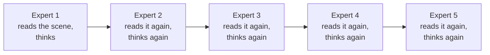
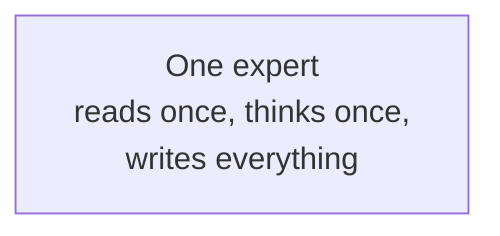
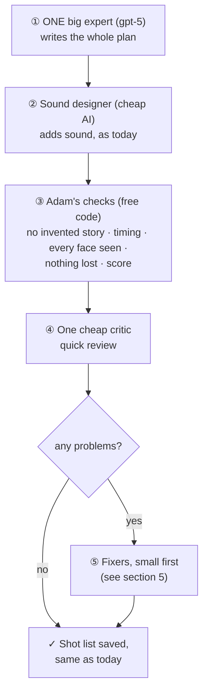
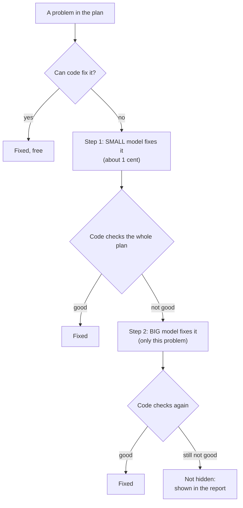
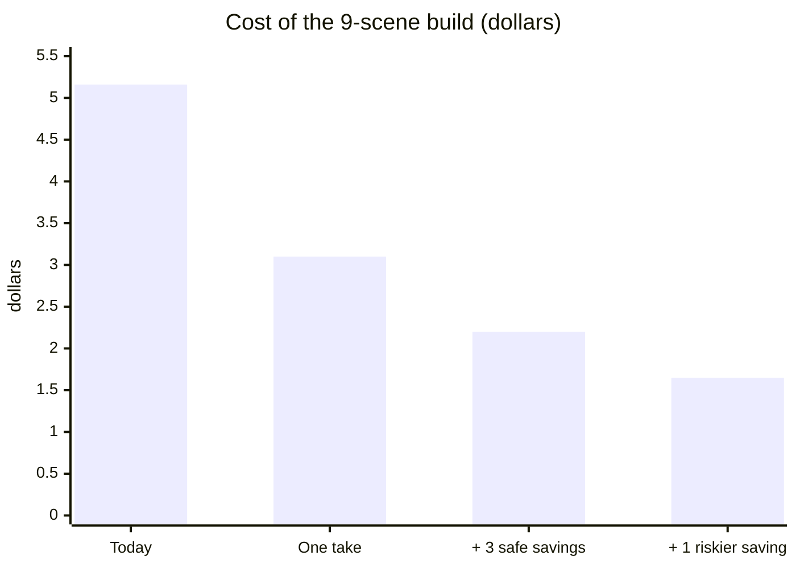
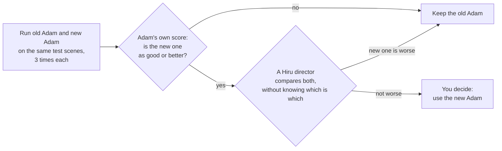
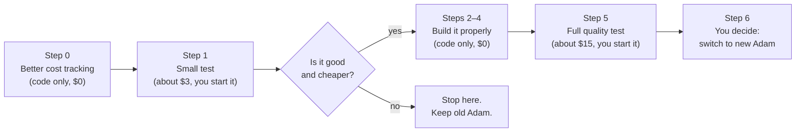

# Making Adam cheaper: the plan in plain words

This is the simple version of [PLAN.md](PLAN.md). PLAN.md has the technical details for building it. This file explains
**what the problem is, what we want to change, and what you need to decide**.

The code for this is now written and tested with pretend model answers (see [IMPLEMENTED.md](IMPLEMENTED.md)). Nothing has
been run on the real model yet, so none of the costs in this file has been measured: the first real numbers come from the spike
(about $3), which only you start.

---

## 1. The problem in one sentence

**Adam makes good shot lists, but one build of 9 scenes cost $5.16, and we want it to cost $1–2 without the shot lists
getting worse.**

---

## 2. Where the $5 went

We looked at the real bill for that build (9 scenes).

| Who in Adam | What they do | Cost |
|---|---|---|
| Shot designer | turns the moments into shots | **$1.79** |
| Reviser | fixes the plan after the critics speak | **$0.92** |
| Director | writes 3 ideas for how to film the scene | $0.81 |
| Moment writer | writes what we see and hear, moment by moment | $0.68 |
| Dramaturg | reads the scene and says what it is about | $0.36 |
| Critics, sound, blocking | 4 critics, sound design, where people stand | $0.16 |
| Not Adam | other parts of the build | $0.44 |
| **Total** | | **$5.16** |

So **one scene costs about 52 cents** with Adam.

### What are we paying for?

The AI (gpt-5) **thinks before it writes**. We pay for the thinking even though we never see it.

- The thinking is about **93% of the bill**.
- The reviser wrote a short answer but thought for a long time. It was billed for about 15 times more words than it wrote.

**The cost is the thinking, not the writing.**

---

## 3. What we discovered

You asked ChatGPT for a shot list of the same scene **in one message**. It gave a list that is **as good as Adam's**,
and in some places better: the smile that stays after the eyes change, and Dasun alone with the empty space at the end.

Adam uses **about 12 AI calls** to make one scene's shot list. ChatGPT used **one**.

### Why is Adam so expensive?

Think of Adam as **five experts in a row**, each working in a separate room:

Each expert has to **understand the whole scene from the beginning**, and we pay for that understanding **five times**.

ChatGPT is **one expert who reads the scene once, thinks once, and writes the whole shot list**.

There is a second problem. When work passes from one room to the next, **some ideas get lost**. Then we pay more
experts (critics and a reviser) to find and fix what was lost. In our test, Dasun's last moment was lost between two
experts, and five extra AI calls tried to get it back.

### So why not just use ChatGPT?

ChatGPT also made mistakes Adam never makes:

- It **added story that is not in the script** ("she takes her bag", "he's in the middle of a story").
- It does not connect each line of dialogue to the real script line.
- It does not check the Veo timing rules (4, 6 or 8 seconds, 2.2 words a second).
- It does not give the exact shot cards the video system needs.

The good news: **all of these checks are done by normal code in Adam, not by the AI.** Code is free and always the
same. So we can keep the checks and change only the AI part.

---

## 4. The idea: "Adam in one take"

**Let one expert write the whole shot list in one go, and keep all of Adam's checks.**

| | Today | One take |
|---|---|---|
| AI calls per scene | about 12 | about 3–4 |
| Expensive AI calls per scene | 5–7 | 1–2 |
| The checks that keep Adam safe | yes | **yes, the same** |
| What you see in the app | shot cards | **the same shot cards** |

The old Adam is **not deleted**. It stays as a switch, so we can compare the two side by side and go back if needed.

---

## 5. Fixing problems: small models first (your idea)

The big expert's plan will be almost complete, but it can still have a few problems. Today **every** fix is done by
the big, expensive model (gpt-5). In the $5 build that fixer cost **$0.92**, and it ran on all 9 scenes.

The new way works like a **junior and a senior editor**: the cheap junior tries first, and the senior is called only
if the junior's fix is not good enough.

### Which problems go where

| Kind of problem | Example | Who fixes it first |
|---|---|---|
| **Mechanical** | a shot too short for its line; wrong numbering | **code** (free) |
| **Small and clear** | "show Dasun's face after shot 6" | **small model** |
| **Creative** | "we need a new moment: Dasun sitting still as she leaves" | **small model**, with the **big model** behind it |

### Three safety rules

1. **Fixers make small edits, never rewrites.** They change one shot or add one moment. The big expert's overall idea
   for the scene stays.
2. **Code checks the whole plan after every fix**, because one fix can break something else.
3. **No endless loops.** At most two tries per problem. If it is still not right, it is shown in the report, never
   hidden.

### If the small model is not good enough

**Which model works on each step is a setting**, not fixed in the code. If the test shows the small model is weak at,
say, creative problems, we change one line and those problems go to a **medium** model instead. No rebuild needed.

---

## 6. How much will it save?

Remember: the main call happens **once per scene**. A 9-scene build means 9 main calls. And $0.44 of the $5.16 was
**not Adam** (other parts of the build), so it stays the same in every number below.

Why one call still costs money: gpt-5 charges for its **hidden thinking** as well as for what it writes. One scene
means about 10,000–15,000 words of thinking, plus a few thousand words of shot cards. That comes to about **15–20
cents**. Your ChatGPT message felt free because it was paid by your subscription; through the API it would cost about
5–15 cents.

These are **estimates**. We cannot know the real number until we try it (see section 9).

1. **One take: about $3.10.** We stop paying for the same thinking five times.
2. **Three safe savings: about $2.20.**
   - The expensive AI **thinks**, and a cheap AI **types** the result into the shot-card format. Typing is simple work.
   - Code **gives the AI the facts it already knows** (word counts, timing), so the AI doesn't spend thinking on them.
   - **Small models do most of the fixes** (section 5), so the big model fixes only what they can't.
3. **One riskier saving: about $1.65.** We ask the main AI to think less, or we try a newer AI model. We only keep
   this if the shot lists are still as good.

**Rebuilding a scene that did not change costs $0.** Today Adam plans it again from zero. In the plan, it reuses the
plan it already made.

### Being clear about the target

- With the safe savings we get to **about $2.20**, close to the target.
- To be **below $2**, we need step 3, and we only keep it if the quality test passes.
- If step 3 fails the quality test, you choose: **$2.20 with the same quality**, or the cheaper "Flex" API, which you
  said you don't want because it is less reliable.

---

## 7. How we make sure quality does not drop

Nothing changes for real productions until it passes these tests.

- **Test 1: Adam's score.** Adam already gives each shot list a score with code. Your ChatGPT-style shot list scored
  100%; today's Adam scored 92–96%. The new one must score at least as well as the old one.
- **Test 2: a director's eye.** A Hiru director looks at both versions without knowing which is new, and picks the
  better one. The new one must not lose.

---

## 8. Reliability

You said you want a **reliable API**, so:

- We use the **normal OpenAI API**, not "Flex".
- **Fewer calls means fewer chances to fail.** 3–4 calls per scene instead of 12.
- **Longer waiting time for long answers.** Today a long answer can be cut off at 3 minutes; it will get 10.
- **One automatic retry** if a call fails. If it still fails, the scene says why, and the classic planner is still
  there.

---

## 9. The steps

| Step | What happens | Costs money? | Who |
|---|---|---|---|
| 0 | Record the AI's hidden thinking in our usage table. Reuse plans for scenes that did not change. | No | me |
| 1 | **Small test:** try 3 versions of one-take Adam on 3 test scenes. Measure the cost and the score. Also count how many problems the small fixer gets right. | **~$3** | **you start it** |
| — | **You look at the results and decide** whether to continue. | | **you** |
| 2–4 | Build the new Adam properly, behind a switch. The old Adam stays. | No | me |
| 5 | **Full quality test:** old and new Adam, 6 scenes, 3 times each, plus the director's blind comparison. | **~$15** | **you start it** |
| 6 | **You decide** whether new Adam becomes the default. | | **you** |

**The important point:** after step 1 we will have **real numbers**, not guesses. If one-take Adam is not good enough,
we stop there, and the only cost is about $3.

---

## 10. What you have decided so far

| Question | Your answer |
|---|---|
| Use the cheaper but less reliable "Flex" API? | **No**, only if there is no other way |
| Let the AI choose the best idea for the scene (and write the other 2 as one-line ideas)? | **Yes** |
| Write sound in the same AI call? | **No**, keep the separate sound designer |
| Read the real cost of the $5 build? | **Yes** (done: the numbers in section 2) |
| Fix problems with small models first, and a bigger model only when needed? | **Yes** (your idea, section 5) |

## 11. What you need to decide now

1. **Is this plan clear and OK?** Anything you want changed?
2. **May I build Step 0** (code only, no AI cost)?
3. After Step 0, **will you run the ~$3 test** (Step 1)?

---

*Technical version: [PLAN.md](PLAN.md). Cost study: <https://claude.ai/artifact/XvTVY4sbThqA4psf6paBwg>.*
