# Shot Planner Adam, faster: plan every scene at once: plan

Status: written 2026-11-05, nothing built. It builds on [plan/2026-11-04b](../2026-11-04b/PLAN.md) (Adam),
[plan/2026-11-04c](../2026-11-04c/PLAN.md) and [plan/2026-11-05](../2026-11-05/PLAN.md) (Adam in one take), and changes
none of their rules. It changes **when** scenes are planned, not **how** a scene is planned.

**Goal:** the 9-scene build that took **34 minutes** takes about **12**, a 20-scene build about **25** instead of ~55,
with **the same model calls, the same prompts, the same plans and the same cost**. About 40 lines of Python, two
config numbers and one deploy setting.

## 1. Where the time goes

The $5 build of 2026-11-04 (job `f89a99a4…`, 9 scenes, 17:56–18:30 UTC) took **34 minutes**. Adam already plans scenes
side by side (`graph.py`: `PLAN_WORKERS = 4`), so the wait is not one scene after another. It is three things:

1. **One wave per delivery.** `plan()` runs waves of 4 and starts a new wave only while under `TIME_BUDGET_S = 420`.
   A staged scene takes about 11 minutes (about 11 model calls in a chain, gpt-5 thinking 4,000–13,000 tokens each), so
   the first wave always passes 420 s. **Every delivery plans only 4 scenes**, then hands the rest to a fresh delivery.
2. **Deliveries run one after another.** 9 scenes = 3 deliveries (4 + 4 + 1) × ~11 min ≈ 34 min. The last delivery
   plans one scene while three of the four seats sit empty.
3. **A wave waits for its slowest scene.** `pool.map` over a wave: nothing is written and no new scene starts until
   all four finish.

```mermaid
gantt
  title Today: 9 scenes (one wave of 4 per 900 s delivery)
  dateFormat mm
  axisFormat %M min
  section Delivery 1
  scenes 1-4 :a1, 00, 11m
  section Delivery 2
  scenes 5-8 :a2, after a1, 11m
  section Delivery 3
  scene 9 :a3, after a2, 11m
```

```mermaid
gantt
  title After: 9 scenes (all at once, one 1800 s delivery)
  dateFormat mm
  axisFormat %M min
  section Delivery 1
  scenes 1-9 :b1, 00, 12m
```





**Inside one scene the work is a chain** (dramaturg → director → moment writer → blocker → designer → sound → critics →
reviser; or take → sound → critic → fixer). Each step reads the one before, and the four critics already run in
parallel (`panels/adam/adam_screening`). There is no safe speed-up inside a scene that keeps the plans the same, so this
plan does not touch it.

## 2. What this plan does not do, and why

| Idea | Why not |
|---|---|
| OpenAI **Batch API** | Half price, but results come back within 24 hours: slower, not faster. |
| **Several scenes in one prompt** | Changes what the model sees and writes; the plans would change and need a new A/B. |
| **Split a scene's chain** into parallel calls | Every stage needs the one before. Running them blind changes the plans. |
| **Parallel deliveries** (shards of scenes, each its own Cloud Task) | Works, but touches the courier (`task_manager.advance`, "functions never enqueue each other"), totals, episode status and the build log. Kept as option §7 for very long productions. |
| A smaller or faster model | Changes quality; that is plan/2026-11-05's question, not this one's. |

## 3. The design: three small changes in one file and two configs

### 3.1 Plan every scene the delivery can hold at once (`ADAM_WORKERS`)

`PLAN_WORKERS = 4` becomes a setting, `ADAM_WORKERS` (default **10**), read in `graph.build`. The thread pool already
exists; only its size changes.

Why 10 is safe for the API: a staged scene uses about 40,000 gpt-5 output tokens over ~11 minutes, so 10 scenes at
once is about **40,000 output tokens a minute** and a few requests a minute, far under gpt-5's per-minute limits on
any paid tier. A 429 is already retried by the client (`retries: 2` per tier). The number is a setting so it can be
lowered without a deploy if the account's limits are lower than expected.

### 3.2 A rolling pool instead of waves

Replace "waves of N, `pool.map`" with "keep N scenes running; when one finishes, write it and start the next":

```python
pending: dict[Future, Row] = {}
queue = list(todo)
first = True
while queue or pending:
    while queue and len(pending) < workers and (first or time.monotonic() - started < limit):
        job, first = queue.pop(0), False
        pending[pool.submit(contextvars.copy_context().run, plan_one, job)] = job
    if not pending:
        break                                   # past the cut-off: the rest go to the next delivery
    finished, _ = wait(pending, return_when=FIRST_COMPLETED)
    for future in finished:
        write_result(pending.pop(future), future.result())   # the existing body of the wave loop, unchanged
left = queue
```

- The body that writes a scene (`write.run`, `replace_shots`, the events) moves into `write_result` **unchanged** and
  still runs **on the main thread**, one scene at a time. Only `plan_one` runs in the workers, as today.
- `contextvars.copy_context()` is still taken per task, in the main thread, so usage logging keeps its job and agent.
- A scene's shots appear in the UI **as soon as that scene is done**, not when its whole wave is.
- The first scene always starts (as today: `if i and …`), so a delivery never ends having done nothing.

### 3.3 A longer delivery and a start cut-off that fits it

| Setting | Today | After | Where |
|---|---|---|---|
| Function timeout | 900 s | **1800 s** | `.github/workflows/deploy-functions.yml` (`hiru-shot-planner-adam`) |
| `FunctionSpec.deadline_s` | 900 | **1800** | `src/api/workers/task_manager.py` (must equal the timeout) |
| `TIME_BUDGET_S`: no new scene starts after | 420 s | **900 s** | `graph.py` |
| Time left for a scene that starts last | 480 s | **900 s** | (deadline − cut-off) |

1800 s is the Cloud Tasks ceiling for an HTTP task's `dispatch_deadline` (30 minutes); Cloud Run functions (gen 2)
allow up to 60 minutes, so the function side is not the limit. The cut-off leaves a late scene **more** room than it
has today (900 s against 480 s), so the risk of a scene being killed by the deadline goes down, not up.

### 3.4 One bug fixed on the way

A continued delivery loses the request's choices. `wrap()` hands on only
`{"build", "scene_ids", "progress"}`, so the next delivery forgets **`mode`** (falls back to `ADAM_MODE`), **`replan`**
(an unchanged scene is now kept instead of planned again) and **`screening`**. Fix: carry
`mode`, `replan` and `screening` in the continued state. With 3.1–3.3 most builds need no continuation, but long
productions still do.

## 4. Why the plans stay the same

- **No scene reads another scene's plan.** `plan_one` reads its own scene, its own lines, its own stored plan, and
  only the headings of the scenes before and after (`surrounding`, from `split.neighbours`, loaded once before
  planning). Order of finishing cannot change any input.
- **Same calls, same prompts, same settings**: `scene.Planner` is not touched. Cost is the same to the cent.
- **Writing stays single-threaded**, in the main thread, so `replace_shots` and the job events behave as today. The
  only visible difference: progress events arrive in finishing order, not scene order. Each event already carries its
  `scene_id`, and the UI places shots by scene.
- **Idempotent as before**: a scene's shots are replaced, never appended. If a delivery is retried, scenes already
  planned are found unchanged by `input_hash` and kept (unless the request says `replan`).

## 5. Phases

### Phase 0: measure (read-only, the person's go-ahead)

From the hosted `job_events` of the 2026-11-04 build and the 2026-11-05 take runs: time from the first event to each
scene's "N shots" event, per scene, per mode. Gives the slowest scene (staged and take) and confirms the 900 s cut-off
leaves enough room. Read-only, and it needs the person's go-ahead because it touches the hosted database.

### Phase 1: code (`graph.py`, `settings.py`)

1. `AISettings.adam_workers: int = 10` (`ADAM_WORKERS` in `.env.example`, documented beside `ADAM_MODE`).
2. `graph.plan`: the rolling pool of §3.2; the write body moved into `write_result`, unchanged.
3. `TIME_BUDGET_S = 900.0` and its comment ("of the 1800 s deadline").
4. `wrap`: carry `mode`, `replan`, `screening` in the continued state (§3.4).
5. Module docstring: "waves of four" becomes "up to `ADAM_WORKERS` scenes at once, each written as it finishes".

### Phase 2: tests (offline, no model)

In `tests/adam/` with a fake `Planner` whose `plan` sleeps a set time and records start and end:

1. **Concurrency:** 9 scenes, `ADAM_WORKERS=10` → all 9 start before any finishes.
2. **Rolling:** 6 scenes, 2 workers, one slow scene → the other scenes are written before it finishes.
3. **Cut-off:** with a tiny budget, the scenes not started are handed on in `left`, in order, and none is lost or
   planned twice.
4. **First always starts:** budget 0 → one scene planned, the rest handed on.
5. **Same output:** the existing graph tests pass unchanged (shots written, totals, events, failures, reused).
6. **One failure does not stop the rest:** a scene that raises `adam.Failed` is recorded in `failed`; the others are
   written.
7. **Continuation keeps the request:** the continued state carries `mode`, `replan` and `screening`.
8. **Usage context:** each worker sees its own copied context (the existing contextvars test, with the pool).

Then the repo checks: `ruff check src tests scripts`, `mypy`, `scripts/lint_imports.py`, `hiru_ai validate`,
`hiru_ai catalog --check`, `pytest -q`.

### Phase 3: deploy settings

`deploy-functions.yml`: `"timeout":1800` for `hiru-shot-planner-adam`; `task_manager.FUNCTIONS`:
`FunctionSpec("hiru-shot-planner-adam", 8209, 1800)`. Memory stays `1Gi` (ten threads mostly waiting on HTTP); raise to
`2Gi` only if Phase 4 shows pressure. The person deploys.

### Phase 4: live check (the person's, it costs model calls)

Plan the same 9 scenes as the 2026-11-04 build with `ADAM_WORKERS=10`. Pass when:

| Check | Pass |
|---|---|
| Wall time | ≤ 15 minutes (today 34), one delivery |
| Cost | within ±10 % of the same build planned before (same calls; gpt-5 reasoning varies run to run) |
| Plans | code score per scene in the same range as before; no new failures |
| Errors | no 429 that ended a scene; no delivery killed by the deadline |

## 6. Expected times (estimates from the one measured build; Phase 0 firms them up)

Assumes a staged scene takes ~11 minutes. Take mode (plan/2026-11-05) has fewer calls in its chain, so each scene and
every number below should be shorter still.

| Scenes | Today (waves of 4, 900 s) | After (10 at once, 1800 s, rolling) |
|---|---|---|
| 1 | ~11 min | ~11 min (one scene's chain is the floor) |
| 4 | ~11 min | ~11 min |
| 9 | ~34 min, 3 deliveries | **~12 min, 1 delivery** |
| 20 | ~55 min, 5 deliveries | **~25 min, 1 delivery** (10, then 10 more as seats free before 900 s) |
| 40 | ~110 min, 10 deliveries | **~50 min, 2–3 deliveries** |

The floor is one scene's chain. Getting below ~11 minutes for a single scene means fewer calls in the chain, which is
what take mode does.

## 7. If productions grow past ~40 scenes: parallel deliveries (not now)

When one delivery is not enough, the courier could send several deliveries at once, each with a slice of
`scene_ids`, and the last one to finish runs `wrap`. This needs a counter on the job row (or a small table) to know
which delivery is last, totals merged across deliveries, and a change to "functions never enqueue each other". It is
a real design change, so it waits until productions of that size are common. Raising `ADAM_WORKERS` gets most of the
same gain first.

## 8. Decisions for the person

| # | Decision | Recommendation |
|---|---|---|
| D1 | `ADAM_WORKERS` default | **10**. Lower it if the OpenAI account's gpt-5 limits are low. |
| D2 | Function timeout 900 → 1800 s | **Yes**: it is what lets one delivery hold a whole build. |
| D3 | Run Phase 0 (read-only timing from the hosted DB) | Yes, before Phase 4. |
| D4 | Parallel deliveries (§7) | **Not now.** |

## 9. Files touched

| File | Change |
|---|---|
| `src/libs/hiru_ai/systems/adam/adam_shot_planner/graph.py` | rolling pool, `write_result`, `TIME_BUDGET_S`, continued state, docstring |
| `src/libs/hiru_ai/core/settings.py` | `adam_workers` |
| `.env.example`, `docs/adam/README.md` | `ADAM_WORKERS` |
| `src/api/workers/task_manager.py` | Adam's `deadline_s` 1800 |
| `.github/workflows/deploy-functions.yml` | Adam's timeout 1800 |
| `tests/adam/…` | the Phase 2 tests |

Not touched: `scene.py`, every agent, prompt and step, the screening panel, the contracts, the database, the interface.
