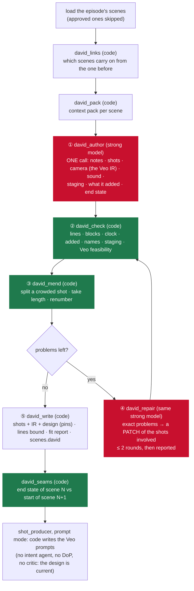

# Shot Planner David: one author, code checks, narrow repair: plan

Status: written 2026-11-05, **nothing built**. Plain-words version: [human-read.md](human-read.md).
Updated 2026-11-05 (final draft): continuity between scenes (D5 reopened, D8, D9) from a conversation the person
shared (§14); chains across deliveries, replans and approved scenes (§4.4); ChatGPT in the spike (D10); measured tokens
(§8).

David is a third shot planner, built beside `script_split` (classic) and Shot Planner Adam
([plan/2026-11-04b](../2026-11-04b/PLAN.md)). It changes neither of them. A production picks it with
`settings.shot_planner = "david"`, as it picks Adam today. David is also the first system built on **the Hiru AI pattern**
(§2), which every later system follows.

**Goal:** David plans a scene's shots **and their camera design** in **one model call** (at most three with repairs). It
keeps every Hiru guarantee in code: no invented story, lines word for word, the Veo clock, continuity. A Hiru director
judging blind must rate its plans at least as good as one message to ChatGPT and as Adam. Target cost: **≤ $0.30 a scene,
camera design included**. Adam costs $0.52 a scene before any camera design.

## 1. Why David: what we found

| Finding | Evidence |
|---|---|
| One ChatGPT message plans a scene as well as Adam's whole pipeline, and slightly better | 100 % vs 92.2 % on Adam's own score; the master the score is held to IS that ChatGPT breakdown ([plan/2026-11-05 §2](../2026-11-05/PLAN.md)) |
| More stages made plans worse, not better | three live runs "passed every code check and got worse" ([plan/2026-11-04c §1](../2026-11-04c/PLAN.md)) |
| The money goes on thinking the same thing again | 5 gpt-5 agents each re-read the scene and the previous agent's JSON; 69 % of the bill is hidden reasoning; $0.52 a scene for Adam alone |
| Intent is lost between agents | "Dasun's held stillness as she goes" was lost between the moment writer and the designer; retries and a revision could not recover it |
| The camera is decided twice | after Adam's cards, the shot producer's DoP (gpt-5) and critic (gpt-5) design the camera again |
| What makes Adam safe is code, not stages | fidelity, the clock, splitting, continuity, coverage and the ledger are pure Python ([plan/2026-11-05 §3 C4](../2026-11-05/PLAN.md)) |
| Built and tested mostly on scripted answers | Adam take mode, the fixer ladder and the whole `AI_ENGINE=graph` engine have never run on a real model |

So David keeps the code that guards and drops the stages that imagine in pieces.

## 2. The Hiru AI pattern

Written once here, then kept as `docs/AI_PATTERN.md` with ADR 0010 (Phase 0). Every new system follows it. A system that
breaks a rule says which rule and why in its plan.

```
          MEMORY (database; written by code or a person): canon cards · looks · production rules · state from before
                                            │  code builds the CONTEXT PACK (no model)
                                            ▼
 ① AUTHOR   one call, strong model: writes the WHOLE creative unit, small format + free text + END STATE
                                            ▼
 ② CHECK    code: pass or fail, each failure an exact sentence
                                            ▼
 ③ MEND     code fixes what code can (split a crowded shot, renumber, pick the take length)
                                            ▼
 ④ REPAIR   only what code cannot: the same strong model gets the exact problems and the shots involved,
            answers with a PATCH; code checks the whole plan again; at most 2 rounds, then it is REPORTED
                                            ▼
 ⑤ SAVE     plan + END STATE back to memory; a person reviews; their change is a card they accept
```

**The eight rules**

1. **One author per creative unit.** A creative unit is the smallest thing that must be imagined as a whole: a scene's
   shots, or one document's story. One call does all of its thinking. No role-play stages.
2. **A second call is allowed only when:** (a) the input does not fit in one call; (b) the step needs a different kind
   of input (an image); (c) many later calls reuse the result (the canon); (d) independent units run at once (scenes,
   episodes). "Another specialist's view" is not a reason. *Exception, if the spike asks for it (D2):* a small model may
   change a free-text answer into the format, because code can check that it changed nothing.
3. **Code judges facts; people judge taste.** No model critic can block a plan. No code score chooses between two
   creative versions.
4. **Repair, don't redo.** Code first, then the same strong model with the exact problem. A small model never reviews or
   fixes the big model's creative work.
5. **Memory in, state out.** Code builds every call's input from the database. Every author call returns an end state
   (who is where, wearing what, holding what; the time and the light) for the next unit.
6. **Small output format.** A field exists only if code or the interface reads it. Creative content stays free text.
   The model writes its notes first and the fields after.
7. **Agent loops with tools only where a person leads** (director chat, search). Production jobs are straight calls.
8. **One path per job, proven on real scenes.** To add a stage or an agent, it must beat the simpler version in a blind
   test on at least 5 real Hiru scenes, judged by a director. **A quality problem is fixed first in the prompt, the
   context pack or a code check, never by adding an agent.**

**Call budget per job.** A job that would go over its budget reports it and does not spend more.

| Job | Model calls |
|---|---|
| Shot plan + camera design for one scene (David) | 1 author + at most 2 repairs |
| A seam between two linked scenes | at most 1 repair |
| Director chat message | 1 agent with tools, at most 6 tool calls (a later plan) |

## 3. David in one picture



Red means a model call, green means code. A scene that passes its checks makes **one** model call, from script to a
design the shot producer turns into Veo prompts in code.

## 4. The parts

### 4.0 Where David lives

Like Adam: a `david/` group folder in each layer that needs one. Ids start with `david_`. A grouped part imports only its
own group, plus core, rag, `contracts` and **shared** steps by id. It never imports Adam. `hiru-ai remove --group david`
lists everything that goes.

```
src/libs/hiru_ai/agents/david/          david_author, david_repair
src/libs/hiru_ai/steps/david/           david_pack, david_links, david_check, david_mend, david_seams, david_write
src/libs/hiru_ai/systems/david/         david_shot_planner
src/libs/contracts/david/               plan.py (the plan), wire.py (what a model writes), stored.py
src/services/shot_planner_david/        the Cloud Run function
tests/david/   tests/eval/david/        tests; the comparison set
docs/david/                             README
hiru-ai-studio-interface/src/features/david/   the David tab (other repository)
```

Outside the group, on purpose (each one line or a small block, added to `MAY_NAME_IT` in `tests/david/test_removal.py`):
`contracts/jobs.py` (job kind), `contracts/build.py` (pipeline branch), `contracts/production.py` (`shot_planner`
literal), `contracts/staging.py` (`AUTHORED` gains `"david"`), `api/routers/scenes.py` and `build.py`,
`api/workers/task_manager.py`, `deploy-functions.yml`, `scripts/start-functions.ps1`, `core/models.yaml` and
`core/settings.py` (two tiers, §4.2), the Database pair, `pyproject.toml` (import-linter), `CLAUDE.md`, the catalog.

### 4.1 Shared code David reuses (none of it changes)

| Shared part | What David uses it for |
|---|---|
| `contracts.sceneplan.scene_items`, step `scene_listing` | the scene's numbered blocks, as code and as the text the model reads |
| `contracts.shotplan` (`shot_clock`, `line_seconds`, `allowed_durations`), `contracts.timing` | the Veo clock: 4 / 6 / 8 s, 2.2 words a second, lead-in and gaps |
| `contracts.stagemap` (`SceneStaging`, `checks`, `teleports`, `line_crossed`, `eyeline`) | David writes a staging map in the same shape; code finds teleports, crossed lines and broken eyelines |
| `contracts.reading` | a person's reading of the scene (holds, turns), if one exists, is given to the author and never replaced |
| step `serialize` (`shots.get_schema()`, `model.pins_for`, `design.design_row`) | the IR David fills is the **same clip schema** the DoP fills; David stores the design with pins, so the shot producer sees it as current |
| step `prompt_lint` | a dry-run prompt per shot is linted before the plan is saved |
| step `serialize.card` | David's `card` uses the same keys, so the existing card handling (camera fields, sound, silence) works unchanged |

### 4.2 Agents

**`david_author`** (tier `author`). One call per scene. Input: the context pack (§5). Output: `DavidWire` (§5).
`finish()` cleans entry by entry, as Adam's agents do: a shot naming a block or line the scene lacks loses that
reference, and a staging mark for an unknown person is dropped. It has no fallback: with no model, the job fails and
names the classic planner (Adam's precedent).

**`david_repair`** (tier `repair`). Input: the plan, the exact problems, the shots involved and two shots either side,
the scene listing, and what an earlier round tried. Output: `PatchWire`, a list of `{replace_from, replace_to, shots}`
plus an optional `end_state`. It cannot rewrite the plan.

**Two tiers** in `core/models.yaml`. Both use one strong model, picked by the spike (D3):

```yaml
author: { model: model_author, effort: effort_author, timeout_s: 600, retries: 1, fallbacks: [] }
repair: { model: model_author, effort: effort_repair, timeout_s: 300, retries: 1, fallbacks: [] }
```

`settings.py` defaults to `model_author = "gpt-5"`, `effort_author = "medium"`, `effort_repair = "low"` until the spike
says otherwise. Changing the model is an environment change, not a code change.

### 4.3 Steps (code, no model)

| Step | Does |
|---|---|
| `david_links` | Which scenes carry on from the one before: same episode, same `location_id`, and `time_of_day` in CONTINUOUS / MOMENTS LATER / SAME TIME (`contracts.screenplay`). A person may link or unlink a pair (`scenes.david.link`). With `settings.david_order = "episode"` (D5) every neighbouring pair in the episode is linked; a pair that is not CONTINUOUS is marked `carry` (looks and what people keep pass on; place, position and light do not). |
| `david_pack` | Builds the context pack (§5) as text, static part first so it caches. |
| `david_check` | Runs every check in §6 and returns problems, each with `code`, `shots`, `sentence`, and whether code can mend it. |
| `david_mend` | Code fixes: picks the shortest take that holds a shot; splits a crowded shot at a block or line boundary (never a deletion, never a trimmed line); renumbers; drops an addition a person removed before. |
| `david_seams` | Compares scene N's `end_state` with scene N+1's first shots. CONTINUOUS pairs: a person in another place without a move, a prop in other hands, other clothes, other light. `carry` pairs: only other clothes, a lost injury, or a kept prop gone. Unlinked pairs (in `linked` order): the same look-only comparison, **reported** and never repaired, so a costume change the next scene cannot know about is at least shown. |
| `david_write` | Writes the rows: `shots` (framing, take, sound mode, link, block range, `card`, `planner = "david"`, `intent.by = "david"`, `ir`, `design` with pins), lines bound to shots and beats, `fit_report` in the classic shape, the staging map, and `scenes.david` (the stored plan, the checks report, what repairs did, the end state, `input_hash`). It refuses an approved scene. |

### 4.4 System: `david_shot_planner`

Job kind `plan_scene_david`, function `shot_planner_david` (port 8210, deadline 1800 s), as Adam's:

- **Order:** unlinked scenes run at once in a rolling pool (`DAVID_WORKERS`, default 10, plan 2026-11-05b's design).
  A chain of linked scenes runs in order inside one worker, each fed the one before's end state. In `episode` order
  (D5) each episode is one chain, and **the episodes still run at once**, one worker each: a 20-episode build takes about
  as long as its longest episode, not the sum. A chain never crosses an episode boundary (§7). A chain cut by the
  budget carries on in the fresh delivery from the end state stored in `scenes.david`, so nothing is held in memory
  between deliveries.
- **Approved scenes in a chain** are never replanned. A David-planned approved scene passes on its stored end state. One
  planned by Adam or classic has none, so the next scene starts from canon and the episode's looks plus any recorded
  look change (D9), and `david_seams` reports that join for a person to check.
- **Budget:** no new scene starts after 900 s; the rest go to a fresh delivery.
- **Reuse:** a scene whose `input_hash` (script, lines, cast, start state, removed additions) is unchanged keeps its
  stored plan, with no call. "Plan with David" sends `replan`.
- **A replan in the middle of a chain** (a script edit, a note, a removed addition) changes that scene's end state.
  The scenes after it are then out of date, because the start state is in their `input_hash`. They are replanned in
  order only until a scene's end state comes out the same as before, so one edit does not replan a whole episode. An
  approved scene stops the cascade, and its join is reported. The David tab says which scenes a replan will touch
  before it starts.
- **Edits:** `{"note": "..."}` makes one repair call with the person's note as the problem.
  `{"remove_added": n}` needs no model: code removes that addition and re-mends.
- **Never:** a critic, a reviser, a score that picks, three treatments, moments, a ledger.

### 4.5 After the plan: the camera is decided once

`design_stale()` (`steps/serialize/model.py`) is empty for a shot whose `ir` and `design.pins` are current, so **the
shot producer does not call the DoP or the critic for David's shots**. With `"david"` in `AUTHORED`, the intent agent is
skipped as it is for Adam's. In `prompt` mode the shot producer writes each Veo prompt **in code** from the IR, as today:
dialogue word for word with the right speaker, voice casting, silence, joins and format. The model's free text fills the
visual sections. A person's `camera_overrides` still win, and a forced redesign still runs the DoP.

### 4.6 Storage

- `shots.planner` check gains `'david'`; new column `scenes.david jsonb not null default '{}'`.
- `ProductionSettings.shot_planner: Literal["classic", "adam", "david"]`; `BUILD_PIPELINE_DAVID` ends in
  `PLAN_SCENE_DAVID`. `ProductionSettings.david_order: Literal["linked", "episode"]` (D5), default set after the spike.
- `scenes.david` holds the stored plan, the checks report, the end state, the look changes (D9), the link to the scene
  before (`link`: `continuous` | `carry` | none, and whether a person set it) and `input_hash`. No other new column.
- One migration, and the Database pair (D7): **folded into v12** if v12 has still not been run on the hosted project,
  else a new **v13** pair. Verified as `Database/README.md` says. Running it on the hosted project is the person's.

### 4.7 API and interface

- `GET /scenes/{id}/david` returns the stored plan (as Adam's endpoint does: plain JSON, the router knows no David types).
- `POST /scenes/{id}/david/plan` `{note?}` and `POST /scenes/{id}/david/added/{n}/remove`, both behind `CanDirect`.
- Interface `src/features/david/`: a **David tab** through the same slot as Adam's. It shows the author's notes, the
  shots, each addition with a Remove button, the checks report (what code mended, what a repair changed, what is
  reported), the end state, the look changes (D9) and the seam reports. A person can link or unlink this scene from
  the one before. **No costs or credits.**

## 5. The author call

**Context pack** (built by `david_pack`, in this order so the first part is cached):

| Part | Holds |
|---|---|
| system prompt (static) | the rules (never invent story, a line is named by id, the Veo clock in words), the output format, ONE worked example; **≤ 2,500 words** (Adam's take prompt: 4,152) |
| production (same for the whole job) | style note, production rules (and plan 2026-11-05d's memory when it exists), the cast cards of people in this episode: name, code, the look worn in this episode, voice |
| scene context | episode title and synopsis, the scene before and after in a line each, the place card and its props, the director's note |
| start state | the linked scene's end state (for a `carry` link only looks and what people keep); else each person's look for this episode from canon, with any look change recorded earlier in the episode (D9) |
| the last shot before (D8) | for a linked scene, the scene before's last shot `ir` **word for word**: all of it for a CONTINUOUS link, only `subjects` for a `carry` link, so the wording of clothes and light matches across the cut. About 500–1,000 tokens |
| the script | numbered blocks (`scene_listing`); per line: id, speaker, word count, the shortest take that holds it (computed by code, so the model does not work it out); a person's reading if any; additions a person removed |

**What the author writes** (`contracts/david/wire.py`; strict schema, no defaults; the IR part is generated from
`clip_schema_veo_3_1.yaml` through the agent's `output_schema` hook, so David and the DoP fill the same IR):

```
DavidWire
  notes      str      FIRST: what the scene is about, where it turns, whose scene it is, the plan in plain words
  shots[]
    n        int
    blocks   [int]    script blocks this shot shows ([] for an added shot)
    lines    [str]    line ids spoken in it, never the words
    over     str      "" or who is SHOWN while a line is heard (a listener shot)
    take_s   4|6|8
    size     WIDE|MS|MCU|CU|TWO|OTS|INSERT
    link     cut|continuous|match
    why      str      one sentence: what this shot does for the viewer
    ir       {setting, cinematography{…}, lighting, subjects[], beats[], audio, first_frame{…}}   the clip schema
    sound    {ambience, effects, music, silence}
  added[]    {shot, kind, what, who[]}        every picture the script does not write; kind from a closed list of 13
  staging    {zones[], marks[]}               contracts.stagemap shape
  end_state  {people[{who, where, facing, holding, look}], props[{what, where}], time, light}
```

The closed list of addition kinds is Adam's (baseline, reaction, listener, insert_detail, hands, pov, atmosphere, hold,
plant, transition, empty_frame, implied_action, move), copied into `contracts/david/plan.py` with a comment naming where
it came from.

## 6. The checks, and who fixes each one

| Check (code) | Fails when | Fixed by |
|---|---|---|
| lines | a line id is missing, used twice, out of order, or unknown | repair |
| blocks | an action block is shown by no shot, or out of order | repair |
| clock | a shot cannot hold its lines and pictures in its take | **mend** (longer take, then a split); repair only if a split would cut a line |
| envelope | the scene needs more than its envelope | **reported**, never squeezed (CLAUDE.md) |
| added | a kind not on the list; `who` names someone not present; an object not in the script or the place card | the addition is **dropped by code** and reported; never sent back |
| names | free text names a person who is not in the scene cast (scan against canon names and nicknames) | repair |
| speech in free text | quoted speech or a line's words in `ir` or `why` | **mend** (removed, as the DoP's is today) |
| staging | a teleport, a crossed line, a broken eyeline (`contracts.stagemap.checks`) | repair (a teleport may get the existing `move:<who>` bridge, as today) |
| heard, not seen | a person only heard (the phone's other end) is in `subjects` or `first_frame` | repair |
| feasibility | readable screen text, a mirror, fast hands, touching, a crowd, a line across two takes | **reported** with the known fix in the first version; repair later if the A/B asks for it (D4) |
| prompt | `prompt_lint` on a dry-run prompt: missing section, wrong duration | mend, else repair |
| seam (linked scenes) | a person moved, changed clothes or hands without it shown (`carry` links: clothes, injuries, kept props only) | 1 repair on the later scene's first shots |
| seam (unlinked, `linked` order) | a look differs from the scene before's end with no change shown | **reported** |
| end state | it names someone not in the scene, puts a person somewhere the last shots and the staging do not, or drops a prop someone still holds | repair (in the same round as the scene's other problems) |

**Repair rules:** problems go in plain sentences ("Line L7 (Anudi, 19 words, 8.6 s) sits in S04, a 6 s take: give it its
own 8 s shot or start S04 on it"). A patch that creates a new failure is refused and counts as a round. After two rounds,
what is left is in the report and on the David tab. A scene is never failed for a reported problem; it is failed only
when there is no usable plan (no model, or the author's answer is unusable twice).

## 7. Continuity

- **Inside a scene:** one author writes all 10–15 shots, so it remembers why the phone was put face-down in shot 1 when
  it is picked up in shot 10. Code checks the staging and the joins.
- **Across scenes:** linked scenes (§4.3) form a chain; each gets the one before's end state as its start, plus the
  last shot's IR word for word (D8): exact wording of a jacket or the light is what keeps Veo consistent. Unlinked
  scenes start from the canon and the episode's looks, which is what a new place or time needs. `david_seams` checks the
  joins of each chain after the episode.
- **Strict or fast (D5).** In `linked` order, a costume change or an injury in scene 3 does not reach scene 6 unless
  they are chained; the seam check only reports it. In `episode` order every scene starts from the one before, so it
  does. Same calls and cost; only the time changes.
- **Look changes inside an episode (D9).** When a person's look at a scene's end differs from its start (a costume
  change, an injury, a wet shirt), `david_write` records `{who, scene, before, after}` in `scenes.david`, worked out by
  code from the start state and `end_state` (no new model field). Canon is never edited: a change is a new entry with
  its scene number, so it can always be traced. Later scenes start from it, and the David tab lists the changes.
- **Across episodes:** the canon and looks (and plan 2026-11-05d's production memory, when built) are the memory. A
  chain stops at the end of an episode: the next episode starts from its own looks. A look change still in force at an
  episode's end (an injury that lasts) is listed on the David tab, and a person can make it a canon look for the
  episodes that follow. David never writes canon itself.

## 8. Cost and time (estimates; the spike measures them)

At gpt-5 list prices ($1.25 input, $0.125 cached, $10 output per million tokens):

| Per scene | Adam (measured 2026-11-04) | David (estimate) |
|---|---|---|
| Planning calls | ~12 (5–7 on gpt-5) | 1 author |
| Repairs | reviser in 9 of 9 scenes | 0–2, about half the scenes need one |
| Camera design after the plan | DoP + critic + up to 1 revision (2–3 gpt-5 calls), not in the measurement | **none** (the IR is in the author's answer) |
| Prompt tokens (gpt-5) | ~36,000 a scene (measured: every agent re-reads the scene and the stage before) | ~6–10k (≤ 2,500-word prompt, cached after the first scene, + the pack; D8 adds ≤ 1k) |
| Output tokens incl. reasoning (gpt-5) | ~48,000 a scene (measured; ~38,000 of it reasoning) | ~14–23k (~6–8k written + 8–15k reasoning) |
| **Cost** | **$0.52, before camera design** | **$0.17–0.27, camera design included** |
| Time | 9 scenes ≈ 34 min (3 deliveries) | one call ≈ 3–6 min; 10 unlinked scenes at once ≈ the slowest call plus repairs; `episode` order (D5): a 9-scene episode ≈ 27–54 min plus repairs, episodes at once |

The unknown is how long one call thinks while writing a full IR for 12–15 shots. If it runs past the 600 s timeout on
long scenes, a scene of more than 20 blocks is written in two halves: the first half's end state starts the second, and
the shots' notes are carried over. This is an exception and the report says so.

## 9. How we know it is better: the gate

- **Test set:** the 5 scenes in `tests/eval/adam/scenes/` (copied to `tests/eval/david/scenes/`; the groups stay
  independent) plus **at least 5 real Hiru scenes** a person chooses (D6), with long scenes, phone calls and crowds.
- **Contestants, per scene:** David; Adam (staged, the current default); the classic planner; one ChatGPT message (a person
  pastes it; `scripts/david_compare.py` reads a pasted text file).
- **Blind:** `scripts/david_compare.py` writes each plan as a plain shot list (size, take, picture, lines, sound), shuffles
  the letters, and makes one HTML page per scene for a Hiru director, with a form: rank the four; 1–5 on "I can see the
  scene", "the feeling lands", "it cuts well", "it is filmable in Veo".
- **Beside it, from code:** fidelity breaks, overruns, unbound lines, staging findings, calls, cost, time (in the script's
  output only, never in the interface).
- **Gate to become a default candidate:** David's median rank ≥ Adam's and ≥ ChatGPT's; zero fidelity breaks; ≤ $0.30 a
  scene with camera design; ≤ 6 min for a scene. If David loses to ChatGPT, the gap is in the prompt, the pack or the
  format. **Change those (rule 8), and do not add an agent.**

## 10. Phases

### Phase 0: the pattern and the folders (offline)
`docs/AI_PATTERN.md` (§2), `docs/adr/0010-one-author-pattern.md`, the `david` group folders with `group.yaml`,
`tests/david/test_removal.py`, the import-linter contract. **Exit:** `hiru-ai validate`, `remove --group david` dry run
lists exactly §4.0.

### Phase 1: contracts and the code (offline)
`contracts/david/` (plan, wire, stored, the kinds), `david_links`, `david_check`, `david_mend`, `david_seams`. Tests use
hand-written plans: the ChatGPT phone-call breakdown (plan/2026-11-05 §11) written as a David plan passes every check, and
mutants fail with the right sentence (a dropped line, a line twice, an invented person, a 19-word line in a 6 s take, a
teleport, the caller in frame, other clothes across a seam with no change shown). **Exit:** every mutant caught; the
mend never deletes a shot or trims a line.

### Phase 2: the author, the pack and the spike
`david_pack`, `david_author` (prompt ≤ 2,500 words, one worked example from `refuses_money`, as Adam's are), scripted eval
cases. `scripts/david_spike.py` (refuses without `--yes`) runs the author on the 5 test scenes, and on the real scenes once
given, in three configurations:
**A** gpt-5 medium, JSON directly; **B** gpt-5 medium, free text then gpt-5-mini to the format (rule 2's exception);
**C** the strongest current OpenAI model the account can use, JSON directly. It prints checks, tokens, cost and time per
scene and writes the plans to `tests/eval/david/spike/`. About **$5–10**.
**ChatGPT early (D10).** A person pastes one ChatGPT answer per scene into `tests/eval/david/chatgpt/<scene>.txt`. The
spike writes David's best configuration and ChatGPT's answer side by side as plain shot lists (the writer
`david_compare.py` uses later, built here), so the person reads them before anything else is built. **Early stop:** if
David is clearly behind ChatGPT on most scenes, the prompt and the pack change and the spike runs again before Phase 3
(rule 8).
**Exit (the person's):** D2 and D3 decided; David reads at least as well as ChatGPT on the side-by-side.

### Phase 3: repair and the system (offline)
`david_repair`, `david_write`, `systems/david/david_shot_planner` (pool, chains, budget, reuse, edits),
`services/shot_planner_david`, job kind, function registration, the migration and Database pair (not run on the hosted
project). **Exit:** `tests/david` pass with scripted answers: a clean scene makes one call; a crowded shot is mended with no
call; a wrong line triggers one repair; two failed repairs are reported, not failed; a chain passes its end state and
last shot on, also across a fresh delivery; in `episode` order a costume change in scene 2 reaches scene 4's pack and is
recorded once (D9); in `linked` order the same change is reported by the seam check.

### Phase 4: the shot producer reads David's design (offline)
`"david"` in `AUTHORED`; a test that a David shot's design is not stale, so no DoP or critic call is made; prompts
serialized from David's IR pass `prompt_lint`. The parity fixtures for classic shots stay byte-identical.

### Phase 5: API and the David tab
The three endpoints, `tests/api` with fakes; the interface's `src/features/david/` tab, `npx next typegen && npm run
check && npm run format:check`.

### Phase 6: the blind comparison (the person's)
`scripts/david_compare.py` on the full test set; a Hiru director fills the forms. **Exit:** §9's gate, met or not.

### Phase 7: the decision (the person's)
If David passes: make it the default for new productions, then a separate plan to retire Adam (`hiru-ai remove --group
adam`) and the classic planner's model calls (its free rules plan can stay as the way out when there is no model).
If it fails: improve the prompt and the pack and run Phase 6 again, without adding stages.

## 11. What David does not do

| Not in David | Why |
|---|---|
| dramaturg, three treatments, moment writer, blocker, designer as separate calls | rule 1: one creative unit, one author |
| critics, reviser, fixer ladder, craft score, coverage grid, ledger | rule 3: code judges facts, a person judges taste; the score that picked plans got worse plans |
| a tool loop for planning | rule 7 |
| a second camera design by the DoP | §4.5: the camera is decided once |
| changes to Adam, `script_split`, `structure_build`, the legacy engines | David sits beside them until the gate; deleting is a later plan |
| reading documents | plan 2026-11-05c (Story Reader) already follows the pattern: one call per document, quotes checked in code |

## 12. Risks

| Risk | Answer |
|---|---|
| Free text can still invent story that code cannot see | `added` must list every invention; the name scan; heard-not-seen check; the David tab shows additions with Remove; the blind test reads for it |
| One long answer hits the timeout | 600 s, one retry, the two-halves rule for scenes over 20 blocks (§8); the spike measures |
| Strict JSON makes the writing flat | notes first; configuration B in the spike; the IR fields are free text |
| The model ignores the clock | code mends most of it for free; the line facts in the pack give the numbers |
| The test set is too small or AI-made | at least 5 real Hiru scenes and a Hiru director (D6); the gate is not met without them |
| A third planner adds to the clutter | Phase 7 retires the loser in a separate plan; David is deletable in one command |
| `episode` order is slow for a long episode | episodes run at once; the setting can go back to `linked`; the spike measures one call's time first (D5) |
| One edit replans a whole episode | the cascade stops at the first scene whose end state is unchanged, or at an approved scene (§4.4) |
| A wrong end state spreads down the chain | code checks each end state against the scene's own shots before saving; `david_seams` reports each join; a person can unlink a pair |

## 13. Decisions for the person

| | Decision | Recommendation |
|---|---|---|
| D1 | The camera design is in the author's answer, so the DoP is not called for David's shots | **yes** (rule 1, and the camera is decided once) |
| D2 | JSON directly, or free text then a small model to the format | the spike decides (A vs B) |
| D3 | Which model and effort for the `author` tier | the spike decides (A vs C); gpt-5 medium until then |
| D4 | Veo feasibility only reported (not repaired) in the first version | **yes**; repair later if the comparison asks |
| D5 | Scene order, as `settings.david_order`. **`linked`**: CONTINUOUS chains in order, the rest at once (fast; a change in an unlinked scene is only reported). **`episode`**: every scene in order from the one before (strict; same calls and cost, slower). | build both (`episode` is "link every pair", little extra code). Default **`episode`**, since the person asked for strict continuity, if the spike's calls are ≤ 6 min (a 9-scene episode then takes about Adam's 34 min today); else `linked` |
| D6 | Who chooses the 5+ real Hiru scenes, and which director judges | the person's |
| D7 | Fold the migration into v12 (if not yet run) or a new v13 | fold into v12 if unapplied |
| D8 | A linked scene's pack carries the scene before's last shot IR word for word (§5) | **yes**; about 500–1,000 more prompt tokens, a fix in the pack (rule 8) |
| D9 | Look changes inside an episode are recorded by code as dated entries in `scenes.david` and carried to later scenes; canon is not edited | **yes**; making one a canon look stays a person's action. Plan 2026-11-05d keeps looks out of its memory, so no overlap |
| D10 | The spike (Phase 2) also reads pasted ChatGPT answers and shows them beside David's, with an early stop | **yes**; it costs a person about 10 minutes of pasting and catches a losing prompt before Phases 3–5 are built |

## 14. Sources

- The analysis of 2026-11-05 (this conversation's report): call counts, the doubled camera design, the size of the system.
- [plan/2026-11-05](../2026-11-05/PLAN.md) §1 (the measured $5 build), §2 (one ChatGPT message), §3 (four causes), §11.
- [plan/2026-11-04c](../2026-11-04c/PLAN.md) §1 (the live runs that got worse).
- A conversation the person shared (2026-11-05) on context between scenes: a fixed bible, a "where things stand" record
  with fixed fields, a short handoff with the last shot word for word, strict continuity means scenes in order, look
  changes logged as new entries with the scene number. Source of D5's `episode` option, D8 and D9.
- Code read for this plan: `contracts/shotplan.py`, `contracts/stagemap.py`, `contracts/bridges.py`, `contracts/build.py`,
  `steps/serialize/` (`model.py` `design_stale`, `card.py`, `schemas/clip_schema_veo_3_1.yaml`),
  `systems/adam/adam_shot_planner/graph.py`, `api/workers/task_manager.py`, `Database/schema_v12.sql` (`shots`, `scenes`).
